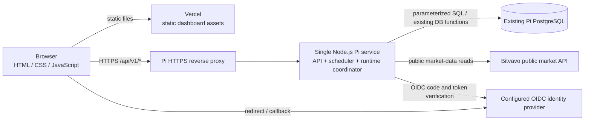

# Target API Architecture

- **Phase:** 1.8 — documentation-only
- **Status:** Phase 1.8 design baseline; the selected Phase 8 dashboard implementation is in progress and has not been deployed
- **Runtime owner:** Raspberry Pi Node.js service
- **Frontend host:** Vercel static files only
- **Database:** the existing PostgreSQL database on the Pi; schema and data are unchanged

> **Phase 8 implementation update:** The approved dashboard integration uses Cloudflare Access JWT validation and a server-side operator email allowlist, with a shared read-only system portfolio. It does not use OIDC application callbacks, Supabase Auth, profile mapping, dashboard write actions, or an admin execution API. The Pi listener remains loopback-only and is intended to be reached through Cloudflare Tunnel. Cloudflare, Vercel and production API connectivity remain unconfigured/unverified; see the [Phase 8 cutover report](../../raspberry-pi/docs/phase-8-dashboard-cutover.md).

The authentication, profile-mapping, admin-action and route proposals in this document are historical design content and are superseded for the current dashboard cutover by the Phase 8 implementation update above. The Phase 8 report is authoritative for implemented API paths and response contracts. This update does not authorize a production deployment, database changes, runtime activation or live trading.

## 1. Ownership and trust boundaries



- Vercel serves only static HTML, CSS, JavaScript, and public non-secret configuration. It has no application API functions, scheduler, database connection, or business logic after cutover.
- The browser calls the Pi API for every operational read, export, and administrative action. It never connects to PostgreSQL, Supabase, Bitvavo trading endpoints, or database functions.
- The Pi Node.js service owns request authentication, authorization, input validation, repository access, and all business logic. It shares the runtime coordinator and PostgreSQL pool with the internal scheduler.
- Bitvavo remains a public market-data source used server-side by the Pi. No private exchange credentials or live-order endpoints are introduced.
- The Pi API never creates or migrates schema, imports Supabase data, or modifies the existing watched-market rows as part of this API design.
- API requests are not execution triggers for scheduled work. There are no public market-refresh, candle-refresh, AI-run, or paper-run scheduler routes.

The public API base is `https://<configured-api-host>/api/v1`. The static dashboard receives this URL through public, non-secret frontend configuration. The actual host, DNS, TLS termination, and Vercel custom-domain configuration must be confirmed before implementation.

## 2. Authentication and authorization

### Identity contract

The target uses a server-mediated OpenID Connect (OIDC) Authorization Code flow with PKCE. The specific identity provider is intentionally not selected by this documentation phase. It must support the required login, callback, session expiry, and account-recovery flows before Phase 3 implementation begins.

1. The browser navigates to the Pi `auth/login` route. The Pi generates and validates `state`, `nonce`, and PKCE values and redirects to the configured provider.
2. The provider returns to the exact registered Pi callback. The Pi validates `state` and `nonce`, exchanges the code server-to-server, validates issuer, audience, signature, expiry, and required identity claims, and maps the verified identity to an existing application profile.
3. The Pi issues a random opaque session cookie. Session material, provider tokens, expiry, and a CSRF token remain server-side in the single Node.js process; they are never returned to JavaScript or stored in PostgreSQL. A Pi process restart invalidates in-memory sessions and requires users to sign in again.
4. The cookie is `Secure`, `HttpOnly`, `SameSite=Lax`, host-only, path `/`, and uses the `__Host-` prefix in production. The browser sends it only to the API host with `credentials: "include"`.
5. `GET auth/session` returns only the authenticated profile's public display fields and a CSRF token for unsafe requests. It does not expose access/refresh tokens or provider claims not required by the UI.
6. Logout invalidates the server-side session, clears the cookie, and uses the provider's revocation/logout endpoint when supported. Expired or unverifiable sessions fail closed with `401`.

The API and dashboard must use HTTPS hosts under the same registrable site so browser cookie and cross-origin behavior is predictable. The API allows credentials only from the exact configured dashboard origin; it never uses wildcard CORS. Unsafe requests require both an exact allowed `Origin` and a session-bound CSRF token in `X-CSRF-Token`. CORS preflight is limited to the documented methods and headers.

### Profile and admin mapping

- Authorization uses a verified OIDC identity (`issuer` plus `subject`) mapped to an existing `AI_Crypto_Bot_Profiles` row. Mapping rules must be verified read-only against the existing Pi data before implementation.
- No profile or mapping table may be added by this phase. If an identity cannot map to an existing profile without schema or data changes, the cutover is blocked for an explicit design decision; do not silently create or rewrite profile rows.
- User-scoped SQL must explicitly constrain reads to the authenticated existing profile. Direct PostgreSQL connections do not inherit Supabase JWT claims or `auth.uid()` semantics; do not assume Supabase RLS alone authorizes Pi API requests.
- Admin authorization is checked server-side on every admin request against an allowlist of existing profile IDs (proposed configuration name: `ADMIN_PROFILE_IDS`). Hiding a link or button in the browser is not authorization.
- Registration, password reset, and password update are provider-hosted or provider-mediated flows. The browser must not load the Supabase JavaScript SDK or submit provider credentials to an application endpoint.

The identity provider, account-claim mapping, existing profile-ID mapping, and admin-ID provisioning are explicit implementation/cutover gates. No default provider or identity mapping is asserted as already configured.

## 3. Endpoint contract

All paths below are relative to `/api/v1`. JSON endpoints use UTF-8 JSON, `Cache-Control: no-store`, bounded request/response sizes, and the common error envelope in §6. The API does not expose generic SQL, table, function, or RPC proxies.

### Authentication endpoints

| Method and path | Access | Purpose and contract |
|---|---|---|
| `GET /auth/login` | Public | Start OIDC login; accepts only a safe internal `returnTo` path and redirects to the configured provider. |
| `GET /auth/callback` | Provider callback | Validate the one-time OIDC state/nonce and code, map the identity to an existing profile, then set the session cookie and redirect to the safe return path. |
| `GET /auth/session` | Session cookie | Return `{ "data": { "authenticated": true, "profile": { ... }, "csrfToken": "..." } }`; unauthenticated returns `401`. |
| `POST /auth/logout` | Session + CSRF | Invalidate the session and clear the cookie; success is `204`. |
| `GET /auth/register` and `GET /auth/recovery` | Public | Redirect to the configured provider's hosted registration/recovery flow where enabled. These routes do not implement password storage or account mutation. |

Static protected-page rewrites are not part of the target: Vercel serves the static page, and the browser guard provides navigation UX only. Every protected data/action API independently authenticates and authorizes each request. Static page paths must not be treated as an access-control boundary.

### Dashboard and market data

| Method and path | Access | Purpose and input |
|---|---|---|
| `GET /dashboard-data` | Authenticated | Existing dashboard summary contract, including portfolio, positions, recent trades, watched markets, decisions, snapshots, status, emergency state, and shadow-exit presentation data. |
| `GET /dashboard-data?view=trade-history` | Authenticated | Existing bounded trade-history view. Preserve supported `page`, `search`, `side`, `period`, and sort filters and the existing response semantics. |
| `GET /dashboard-data?view=analytics&period=30d\|90d\|365d` | Authenticated | Read-only analytics over existing records; preserve current bounded-history and data-quality semantics. |
| `GET /dashboard-data?view=recommendations&period=30d\|90d\|365d` | Authenticated | Generate current advisory recommendations on demand from existing data; do not persist recommendation history or change strategies/risk settings. |
| `GET /dashboard-data?view=export-count&type=...` | Authenticated | Return the selected existing export's bounded row count and validated period. |
| `GET /dashboard-data?view=export&type=...` | Authenticated | Stream the existing CSV export. Validate type/period before starting the response; a later stream failure terminates the stream and must not be represented as a successful partial export. |
| `GET /agent-status` | Authenticated | Return `{ "data": { "status": "ACTIVE\|ANALYZING\|IDLE\|STOPPED\|ERROR" } }`; a missing/unknown stored status remains `null` and is rendered as unknown. |
| `GET /market-summary` | Authenticated | Return the stored market summary and scanner rankings for all existing enabled watched markets. Preserve the current 24h/7d/30d ranking shape and bounded results. |
| `GET /market?symbol=BTC-EUR&interval=1m&limit=200` | Authenticated | Return stored snapshot/candles for a valid enabled market. Support the existing six intervals and `limit` 1–500; reject disabled/untracked symbols. |
| `GET /health/summary` | Authenticated | Read-only dashboard health summary for the Pi runtime, PostgreSQL reachability, disk usage, and last successful cycle. Return only bounded status/metric fields; never credentials, host details, query text, or raw database errors. |

The supported `dashboard-data` views are exactly `dashboard` (default), `trade-history`, `analytics`, `recommendations`, `export-count`, and `export`. The current `archive-health` view is replaced by `/health/summary`, because the Pi API and runtime now share the Pi host. Unknown or repeated `view` parameters return `400`.

Views retain the current `{ "data": ... }` response wrapper and existing property names unless a separately approved implementation phase identifies a necessary compatibility change. Preserve UTC timestamps, empty-success results, bounded pagination, analytics methodology, scanner ranking rules, and export behavior documented in [API.md](../API.md). Authenticated responses are never publicly cacheable.

### Admin and health endpoints

| Method and path | Access | Purpose and input |
|---|---|---|
| `GET /admin-actions` | Admin | Return `{ "data": { "isAdmin": true } }`; authenticated non-admins receive `403`. |
| `POST /admin-actions` | Admin + CSRF | Accept only `{ "action": "ai-analysis" }` or `{ "action": "paper-trading" }`. Return the existing service result and bounded `executionDurationMs` metric. |
| `GET /health/live` | Public, minimal | Process liveness only; returns no database status, configuration, or runtime details. |
| `GET /health/ready` | Private monitoring network or authenticated operator | Read-only readiness for API configuration and PostgreSQL connectivity. Return only `200` or `503` and a coarse state. |
| `GET /health/operational` | Admin | Return bounded runtime state, last cycle/stage, safe resource metrics, and failure counts for operations. No credentials, SQL, or sensitive payloads. |

The Admin page keeps its existing two actions. They call the same Pi services and coordinator as scheduled work; they do not bypass AI status, paper-only mode, freshness, risk controls, emergency stops, or idempotency. Admin-triggered AI analysis remains an AI-only action; admin-triggered paper trading consumes the existing eligible decisions as it does today. A request conflicting with an active AI/paper/cycle operation is rejected with `409` (or `429` when rate-limited); it never starts a concurrent run. No endpoint is added for direct trades, market-list edits, strategy changes, emergency-control changes, or live trading.

### Runtime-only operations (not HTTP endpoints)

The Pi's internal scheduler invokes market-snapshot refresh, candle refresh, AI analysis, paper trading, status updates, and sleep through the single runtime coordinator. These are not public API paths and are not triggered by Vercel, the dashboard, external schedulers, cron, or `systemd` timers. `systemd` starts and supervises the one Node.js service only. The runtime order, locking, and recovery rules are defined in [runtime-execution-spec.md](./runtime-execution-spec.md).

## 4. Dashboard request flows

### Authenticated page load and data polling

```mermaid
sequenceDiagram
    participant B as Browser
    participant V as Vercel static host
    participant P as Pi API
    participant I as OIDC provider
    participant D as Existing Pi PostgreSQL

    B->>V: GET static dashboard assets
    B->>P: GET /api/v1/auth/session (credentials include)
    alt no valid session
        P-->>B: 401
        B->>P: GET /api/v1/auth/login?returnTo=...
        P->>I: OIDC Authorization Code + PKCE
        I-->>P: callback code + state
        P->>I: server-side code exchange and verification
        P-->>B: Secure HttpOnly session cookie + safe redirect
    else valid session
        P-->>B: profile display fields + CSRF token
    end
    B->>P: GET dashboard/market API (cookie; no-store)
    P->>D: scoped, parameterized read
    D-->>P: bounded existing data
    P-->>B: { data: ... }
```

- The browser uses a single configured API base and sends credentials only to that host. `401` starts the login flow; `403` shows an access-denied state; a network/`5xx` failure does not fabricate empty business data.
- Data requests use `GET`, no-store, and validated query parameters. For multi-call pages, request overlap is prevented per view and identical polls are coalesced.
- The browser renders API data only. It may format values and manage presentation state, but it does not calculate trading decisions, rankings, risk outcomes, or portfolio aggregates.

### Admin action flow

The Admin page first calls `GET /admin-actions`. For an action, it sends one CSRF-protected `POST /admin-actions` to the Pi. The API authenticates the session, checks the current profile against the admin allowlist, validates the action, and submits it to the shared runtime coordinator. The response is the service outcome; if the coordinator is busy, the API reports a retryable conflict and the browser does not retry automatically.

## 5. Polling and refresh behavior

Supabase Realtime is removed from the target browser architecture. The initial target uses bounded HTTP polling rather than introducing WebSockets or a second push system. Keep immediate page-load/period-change requests, pause periodic reads while a tab is hidden, refresh on visibility return, and prevent overlapping requests.

| Dashboard surface | Target visible-tab cadence |
|---|---:|
| Dashboard summary | 30 seconds |
| Agent status | 15 seconds |
| Portfolio and trade history | 30 seconds |
| Market Scanner summary | 30 seconds |
| Recommendations | 30 seconds |
| Analytics | 30 seconds while open, in addition to initial/period-change load |
| Pi health summary | 5 minutes |
| Exports and admin actions | User initiated; no automatic retry |

The 30-second data polling preserves the current polling fallback and replaces Realtime invalidations; some updates may therefore appear later than the former event-driven refresh. Respect `Retry-After`; on transient failures use bounded backoff (5, 10, 20, 40, then at most 60 seconds), reset after success, and keep the last successful render visibly stale rather than presenting it as fresh. `401` is not retried; `429` and `503` are not retried before the server-directed/backoff delay. No poll may trigger an AI or paper-trading run.

## 6. Errors and response handling

Success uses the established `{ "data": ... }` envelope; CSV exports use `text/csv` and the existing download headers. Errors use:

```json
{
  "error": {
    "code": "DATABASE_UNAVAILABLE",
    "message": "The requested data is temporarily unavailable.",
    "requestId": "bounded-correlation-id"
  }
}
```

`message` is safe for display. Internal logs may record the request ID, operation name, allowlisted database error code, HTTP status, and bounded duration/count metrics, but never credentials, raw SQL values, session contents, full upstream bodies, or secret-bearing URLs.

| HTTP | Use |
|---:|---|
| `400` | Invalid view, filter, period, market symbol, interval, limit, or action body. |
| `401` | Missing, expired, invalid, or unmappable authenticated session. |
| `403` | Valid user is not authorized for the requested resource/admin action, or CSRF/origin validation failed. |
| `404` | Unknown route or market not in the enabled Pi market universe. |
| `405` | Unsupported method; include `Allow`. |
| `409` | Runtime coordinator is already running a conflicting operation. |
| `413` | Request exceeds the documented body limit. |
| `429` | Rate limit reached; include `Retry-After`. |
| `500` | Unexpected internal failure; return only a generic message and request ID. |
| `503` | Database/provider/auth dependency unavailable or API not ready. |

Database/schema/permission failures fail closed. Do not convert an unavailable read into a success-shaped empty portfolio, scanner, analytics, or history response. Empty results are successful only when the underlying query succeeded. Health endpoints may report an explicit unavailable state without exposing failure internals. If a CSV stream fails after headers are sent, terminate it; do not claim a complete export.

## 7. Rate limits and resource bounds

These are initial target ceilings to implement and validate on the Pi; they are not current production measurements. Rate limits protect HTTP resources and never change scheduler cadence, market coverage, or trading rules.

| Request class | Initial ceiling |
|---|---|
| Authenticated ordinary reads | 60 requests/minute per profile and source IP |
| Analytics, recommendations, export counts | 6 requests/minute per profile; at most one active heavy read per profile |
| CSV downloads | 3 starts/minute per profile; one active stream per profile |
| Admin actions | 2 requests/minute per profile, additionally serialized by the runtime coordinator |
| Login/recovery starts | 10 requests/15 minutes per source IP; repeated invalid callbacks are separately throttled |
| Public liveness | 30 requests/minute per source IP; no sensitive response fields |

Use the reverse proxy for coarse source-IP limits and the Node API for authenticated per-profile limits. Trust forwarded client-IP headers only from the configured reverse proxy. Limit JSON action bodies to 64 KiB, query strings and pagination to documented bounds, database rows/pages to existing caps, and export streams to one per profile. Return `429` with `Retry-After`; do not queue unbounded work.

The existing runtime limits in [runtime-execution-spec.md](./runtime-execution-spec.md) remain authoritative for DB pool size, worker concurrency, 100-market coverage, and cycle duration. Dashboard requests share the bounded pool and must not starve or create another scheduler/AI/paper executor.

## 8. Transport and operational security

- Terminate TLS at a trusted Pi-side reverse proxy; the Node service binds to loopback/private interface only. Do not expose PostgreSQL or the Node listener directly to the public Internet.
- Permit only the exact dashboard origin for credentialed CORS; set `Vary: Origin`, `X-Content-Type-Options: nosniff`, and an appropriate `Referrer-Policy`. Do not place API credentials in static Vercel configuration.
- Authenticate every protected request at the API boundary. Do not trust browser route guards, hidden UI controls, supplied profile IDs, or user-supplied role fields.
- Use parameterized SQL, explicit user/profile scoping, allowlisted views/actions, and strict input/output validation. No arbitrary table, SQL, or database-function invocation is exposed.
- Keep provider secrets and PostgreSQL credentials only on the Pi. Redact cookies, authorization headers, CSRF values, tokens, passwords, and connection strings from logs.
- Return `Cache-Control: no-store` for all authenticated API data and errors. Do not put user data in shared Vercel caches.
- Liveness/readiness requests are read-only and cannot run scheduler work or modify bot status. Detailed diagnostics require an authenticated admin.

## 9. Current-to-target route mapping

| Current surface | Target after cutover |
|---|---|
| Supabase JS Auth, `/api/protected-page` | Cloudflare Access login redirect; Pi validates the Access JWT and allowlisted operator email. Static page guards are UX only. |
| `/api/dashboard-data`, `/api/agent-status`, `/api/market-summary`, `/api/market` | Read-only Pi endpoints under `/api/v1`; the browser uses the configured runtime API origin. |
| `/api/dashboard-data?view=archive-health` | Pi `GET /api/v1/monitoring`; supplies runtime, host and database monitoring fields. |
| `/api/admin-actions` | No dashboard replacement; admin execution controls are removed and the API remains read-only. |
| `/api/market-refresh`, `/api/candle-refresh` | Internal Pi scheduler stages; no public replacement routes. |
| `/api/ai-analysis`, `/api/paper-trading` scheduler endpoints | Internal runtime coordinator only. Admin API actions remain authenticated, manual, and separately serialized. |
| Supabase Realtime table subscriptions | Bounded visible-tab polling against the Pi read APIs; no direct browser database connection. |
| Supabase Auth/PostgREST/RPC dashboard calls | Cloudflare Access JWT validation and explicit read-only Pi PostgreSQL repositories using the installed schema. |

## 10. Acceptance criteria and implementation gates

Before the API can be accepted for cutover:

1. A provider-neutral OIDC contract is implemented with a selected provider, exact callback/origin configuration, protected cookie, CSRF, logout, and expiry tests.
2. Read-only validation proves how provider `issuer+subject` maps to the existing profile rows and how the admin allowlist maps to existing IDs. No schema or market rows are changed.
3. All dashboard pages, filters, charts, scanner rankings, analytics, recommendations, CSV exports, health card, login/recovery, and Admin Actions use only the Pi API and retain their existing response/UI semantics.
4. Every user-scoped query is explicitly constrained to the verified profile; unauthorized access cannot retrieve another profile's data.
5. API method, input, auth, role, rate-limit, CORS, CSRF, dependency-failure, and response-shape tests pass. No database or upstream failure returns fabricated empty data.
6. A second manual/scheduled AI or paper action is rejected/serialized by the same runtime coordinator. API reads cannot start or overlap execution cycles.
7. Polling pauses while hidden, resumes on foreground, respects backoff/`Retry-After`, and never overlaps the same view request.
8. Vercel contains only static frontend assets after user-controlled deployment; no Vercel Function, cron, external scheduler, or separate timer executes Pi-owned work.
9. HTTPS, reverse-proxy source trust, rate limits, request/response bounds, log redaction, liveness/readiness behavior, and Pi resource limits are verified on the target hardware.
10. `ENABLE_LIVE_TRADING=false` is verified and no endpoint can send a real order.

The concrete provider, DNS/custom domains, TLS/reverse-proxy ownership, profile identity mapping, admin profile IDs, and Pi-side firewall/access policy remain unverified and block implementation/cutover until explicitly resolved. No production API endpoint is asserted to exist yet.
