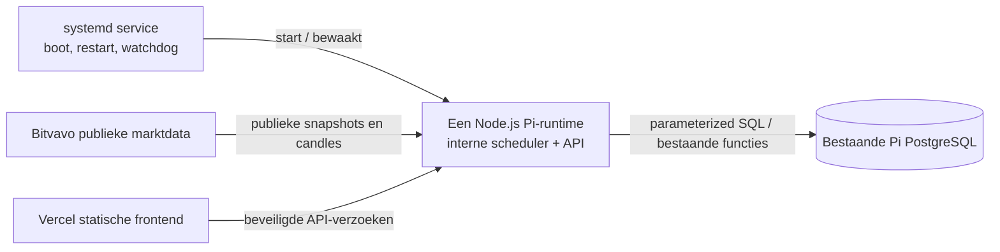
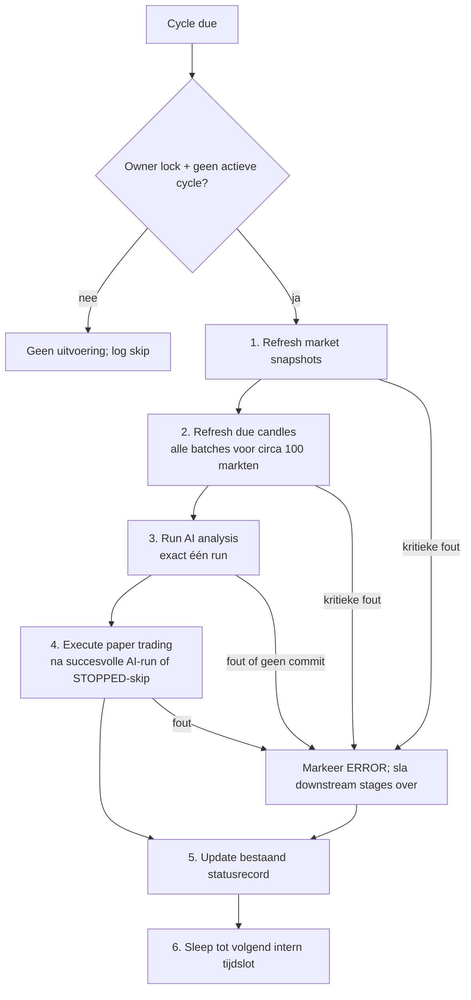

# Runtime Execution Specification

- **Fase:** 1.7 — documentatie-only
- **Status:** Normatieve doelconfiguratie voor de Raspberry Pi-runtime
- **Scope:** runtime lifecycle, scheduling, marktdata, AI-analyse en paper trading

Deze specificatie geldt voor de runtime na de gecontroleerde cutover. De huidige Vercel-endpoints en externe schedulerbeschrijvingen in bestaande documentatie beschrijven de situatie vóór die cutover. Deze specificatie wijzigt geen applicatiecode, databaseobjecten, instellingen of productieplanning.

## 1. Bindende grenzen

- De Raspberry Pi is de enige eigenaar van cyclische marktdata-ingestie, AI-analyse en paper-trading-uitvoering.
- Eén langlopend Node.js-runtimeproces bevat de interne scheduler en voert de volledige pipeline uit. Er is geen externe scheduler, Vercel-executor of afzonderlijke `systemd`-timer.
- `systemd` beheert uitsluitend starten bij boot, procesherstel na crash en procesbewaking.
- De runtime gebruikt de bestaande PostgreSQL-database en past zich aan het bestaande schema aan. Tabellen, functies, views, constraints, historie en marktrijen blijven ongewijzigd.
- De bestaande `AI_Crypto_Bot_Watched_Markets`-tabel is de enige bron van de circa 100 ingeschakelde markten. De runtime leest deze read-only; geen configuratie, synchronisatie of seed mag markten toevoegen, wijzigen of verwijderen.
- AI-score, indicatoren, confidence, signalen, freshness, scanner-rangschikking, paper-uitvoering en risicoregels blijven gelijk aan de bestaande implementatie.
- Paper trading blijft actief. Startup faalt gesloten tenzij `ENABLE_LIVE_TRADING=false`; er zijn geen private exchange- of live-orderaanvragen.
- Historische data blijft behouden en toegankelijk. De runtime voert geen retentie, truncatie, archivering of automatische dataopruiming uit.
- De browser krijgt geen PostgreSQL-verbinding of databasegeheim. Dashboard- en adminverzoeken die een AI- of paper-actie vragen, gaan door dezelfde Pi-runtimecoördinator en kunnen geen tweede uitvoeringspad starten.

## 2. Procesmodel en eigenaarschap

`systemd` start één service voor de runtime. Er is geen tweede workerproces en geen timer-unit. I/O mag binnen één cycle begrensd parallel lopen; AI- en paper-tradingruns lopen elk maximaal één tegelijk en nooit naast elkaar.

Een PostgreSQL-session advisory lock geeft de runtime exclusief eigenaarschap. De lock gebruikt een gereserveerde sleutel die aantoonbaar verschilt van bestaande database-locks, waaronder de paper-run-lock `882018081`. De lockverbinding blijft open zolang het proces eigenaar is. Als de lock niet verkregen kan worden, voert het proces geen werk uit en start het geen standby-pipeline.

Naast de database-lock houdt de scheduler een process-local `cycleActive`-guard aan. De database-lock beschermt tegen een tweede proces; de guard beschermt tegen overlap binnen hetzelfde proces. Beide moeten actief zijn voordat een cycle start.

## 3. Lifecycle

### Startup

1. `systemd` start de runtime bij boot of na een onverwachte procesbeëindiging. Het start geen taak op een timer.
2. De runtime valideert configuratie en geheimen zonder waarden te loggen. Ontbrekende databaseconfiguratie of `ENABLE_LIVE_TRADING` anders dan exact `false` blokkeert uitvoering.
3. De runtime opent de begrensde PostgreSQL-verbinding en verkrijgt de exclusieve session advisory lock. Een tweede instantie stopt zonder cycle.
4. Voer uitsluitend read-only readinesscontroles uit: database-identiteit, verbinding, bestaande tabellen/functies/views, benodigde rechten en bereikbaarheid van de Watched Markets-bron. Geen DDL, migratie, seed of marktmutatie.
5. Controleer de bestaande `AI_Crypto_Bot_Status`. Een `STOPPED`-status wordt nooit automatisch gewist. Als `ANALYZING` achterbleef terwijl de runtime-lock vrij is, registreer dan een onderbroken run en zet uitsluitend het bestaande statusrecord consistent op `ERROR` met `is_active=false` en `is_analyzing=false`. Ga pas verder nadat de marktdata opnieuw is ververst.
6. Start de interne scheduler op de eerstvolgende geldige cycle. Gemiste cycles worden niet als reeks ingehaald.
7. Voer de pipeline uit in de vastgelegde volgorde. AI en paper trading worden pas gestart wanneer de voorgaande vereiste stages succesvol of per markt veilig als gedeeltelijk zijn afgehandeld.

### Graceful shutdown

1. Bij `SIGTERM`/`SIGINT` markeert de runtime zichzelf als stopping en plant geen nieuwe cycle of handmatige actie in.
2. Rond de actieve begrensde aanvraag of database-transactie af, maar start geen volgende pipeline-stap die niet meer veilig kan worden voltooid.
3. Gebruik een shutdown-grens van maximaal 120 seconden. Bij overschrijding wordt de actieve aanvraag afgebroken; een open PostgreSQL-transactie wordt door disconnect teruggedraaid.
4. Sluit de pool en de lockverbinding. PostgreSQL geeft de session advisory lock vrij.
5. Een normale service-stop wist geen noodstop en wijzigt geen handels-, portfolio-, beslissings- of historische rijen. Werk status alleen naar `IDLE` bij als geen cycle actief is en de bestaande status niet `STOPPED` is; bij database-uitval wordt de status niet geforceerd.

### Recovery na reboot of crash

- Na reboot start `systemd` dezelfde service. Na crash herstart het de service met een begrensde restart-delay; bij vijf mislukte starts binnen tien minuten blijft de service gestopt voor operatoronderzoek.
- Een crash sluit de PostgreSQL-sessie en geeft de advisory lock vrij. Een tweede runtime kan pas daarna eigenaar worden.
- De runtime voert na herstel één actuele refreshcyclus uit; hij replayt geen gemiste AI- of paper-cycli.
- Snapshot- en candlewrites gebruiken de bestaande upsert-/sleutelcontracten. Een afgebroken transactie wordt teruggedraaid; een al gecommitteerde write wordt bij herhaling idempotent verwerkt.
- Een onderbroken AI-run wordt hervat met dezelfde deterministische beslissingsidentiteit voor exact dezelfde invoer. De bestaande beslissing wordt niet opnieuw ingevoegd of overschreven.
- De bestaande paper-tradingfunctie blijft verantwoordelijk voor transactionele uitvoering, lock en trade-idempotency. Een herhaalde run mag dezelfde portfolio/beslissing niet opnieuw uitvoeren.
- Een storing veroorzaakt geen onbeperkte retryloop of catch-upstorm. Herstelpogingen gebruiken begrensde exponential backoff; volgende normale cycles blijven de gemiste candleachterstand stapsgewijs verwerken binnen de bestaande limieten.

## 4. Scheduler en cyclefrequentie

De scheduler draait in het Node-proces. Hij gebruikt UTC voor tijdslots en een monotone klok voor duurmetingen en sleep. Lokale tijd, DST, externe cronexpressies en netwerkcallbacks bepalen geen uitvoering.

- Nominale cycle: iedere vijf minuten voor market snapshots, AI en paper trading. Dit sluit aan bij de gedocumenteerde vijfminuten-snapshotcadans en ongeveer vijfminutenafstand tussen opgeslagen AI-besluiten.
- Candle-intervallen worden intern alleen uitgevoerd wanneer ze volgens hun intervalplanning aan de beurt zijn. Alle verschuldigde batches van een interval moeten in dezelfde candle-stage worden afgehandeld voordat AI start.
- De repository documenteert `1m`-candles iedere vijf minuten, `5m`-candles iedere vijftien minuten en `15m`-candles iedere dertig minuten. De daadwerkelijk ingestelde productieplanning is niet onafhankelijk gecontroleerd. De exacte actieve cadans voor `1h`, `4h` en `1d` moet vóór cutover read-only worden vastgesteld en ongewijzigd naar de interne scheduler worden vertaald.
- De cyclefrequentie mag niet stilzwijgend worden verlaagd of verhoogd: dat kan freshness, signalen en trades veranderen.
- Als een cycle zijn volgende vijfminutenslot mist, overlapt hij niet met zichzelf en worden gemiste slots niet gebufferd. De runtime registreert een overrun en wacht tot het eerstvolgende toekomstige slot. Herhaalde overrun blokkeert productieacceptatie.

## 5. Verplichte pipelinevolgorde

### 1. Refresh market snapshots

- Lees de volledige ingeschakelde markt-universe rechtstreeks uit `AI_Crypto_Bot_Watched_Markets`, gesorteerd op `priority ASC, symbol ASC`.
- Verwerk alle circa 100 markten; een test met 10 of 20 markten bewijst geen productiecapaciteit.
- Haal alleen publieke Bitvavo-marktdata op. Schrijf uitsluitend naar de bestaande marktdata- en eventobjecten.
- Bij providerfouten blijven bestaande snapshots intact. Een markt met ontbrekende of te oude data wordt door de bestaande AI-freshnessregels veilig afgehandeld.
- Een ontbrekende/gewijzigde Watched Markets-tabel of mislukte databaseverbinding is een globale fout; de runtime gaat niet terugvallen op `config/markets.js`.

### 2. Refresh candles

- Ondersteunde intervallen blijven `1m`, `5m`, `15m`, `1h`, `4h` en `1d`.
- Gebruik de bestaande incrementele timestamp-checkpoint- en candle-upsertsemantiek; bestaande historie blijft behouden.
- De bestaande batchgrootte is maximaal vijf markten. Voor 100 ingeschakelde markten zijn dat 20 batches per verschuldigd interval. Geen batchindex mag worden overgeslagen.
- Begin met maximaal vier gelijktijdige market-data/I/O-werkers. Er is één scheduler en één cycle; die workers voeren geen aparte AI- of paper-pipeline uit.
- Respecteer de bestaande providercache, request-timeouts, freshnesschecks en maximaal 500 opgehaalde candles per refreshaanvraag. Een langere achterstand wordt over latere cycles ingehaald; geen onbeperkte backfill in één cycle.
- Partiële providerfouten blokkeren niet automatisch alle markten. Laat de bestaande AI-freshnessvalidatie per markt bepalen of data bruikbaar is. Kritieke opslag-/databasefouten stoppen AI en paper trading voor die cycle.

### 3. Run AI analysis

- Start pas na de candle-stage en voer precies één AI-run uit.
- Gebruik alle ingeschakelde markten en behoud de bestaande V2-score, confidence, indicatoren, freshness, beslisregels en bestaande veilige `WAIT`/`HOLD`-uitkomsten.
- De bestaande analyse leest maximaal 150 candles per markt per interval. Bij 100 markten en zes intervallen is de bovengrens 90.000 candle-rijen per volledige analyse.
- De huidige compacte candle-read groepeert maximaal vier markten per interval: bij 100 markten zijn dat maximaal 25 readgroepen per interval en 150 groepen voor zes intervallen. Beperk de Pi-runtime tot maximaal vier gelijktijdige reads; verhoog de huidige 24-request-concurrency niet.
- Verwerk geen gedeeltelijke beslissingsrun als succes. De persistente decisionset voor de cycle wordt transactioneel gecommit voordat paper trading kan starten.
- **AI-idempotency zonder schemamutatie:** de bestaande beslissingstabel heeft volgens het repositorycontract een UUID-primary-key `id`, maar geen unieke constraint op markt plus invoerfingerprint. De runtime moet daarom een deterministische UUID voor `id` afleiden uit de markt, engine-/strategieversie en canonieke fingerprint van de exacte snapshot-, candle- en freshness-inputs. Schrijf met `ON CONFLICT (id) DO NOTHING`; overschrijf een bestaande beslissing nooit. De primaire sleutel en directe rolrechten moeten read-only zijn bevestigd vóór implementatie. Bij een bestaand ID met afwijkende payload faalt de run gesloten en wordt paper trading overgeslagen.

### 4. Execute paper trading

- Start na een volledig gecommitte AI-run. Bij een intentionele `STOPPED`-skip mag de bestaande paper-functie nog eenmaal worden aangeroepen om opgeslagen beslissingen volgens haar bestaande regels af te handelen; de functie blokkeert nieuwe BUY's bij `STOPPED` en kan een geldige SELL afhandelen. Een technische AI-fout of gedeeltelijke decision-commit leidt nooit tot paper-executie.
- Roep de reeds bestaande `AI_Crypto_Bot_Run_Paper_Trading()`-functie aan; wijzig de functie en haar risicoregels niet.
- Er is maximaal één paper-run actief. De bestaande PostgreSQL advisory lock en trade-idempotency-key op portfolio/beslissing blijven de laatste verdedigingslaag.
- `ENABLE_LIVE_TRADING` moet exact `false` blijven. Geen private Bitvavo API of orderendpoint wordt aangeroepen.
- Een databasefout resulteert in een mislukte cycle; er is geen success-shaped fallback of tweede executor.

### 5. Update status

- Schrijf alleen naar het bestaande `AI_Crypto_Bot_Status`-record en gebruik uitsluitend de reeds toegestane statussen `ACTIVE`, `ANALYZING`, `IDLE`, `STOPPED` en `ERROR`.
- Toon `ANALYZING` tijdens de analyse, zodat bestaande statusconsumenten en paper-safetychecks dezelfde toestand blijven zien.
- Na een volledige succesvolle cycle wordt de bestaande successtatus bijgewerkt. Bij een kritieke stagefout wordt `ERROR` en een veilige foutmelding opgeslagen.
- Een bestaande `STOPPED`-noodstatus wordt nooit door startup, recovery of een succesvolle refresh gewist.
- Als de statuswrite mislukt, wordt dat expliciet gelogd; de runtime voert geen volgende handelsactie uit waarvan de status/AI-commit niet aantoonbaar is.

### 6. Sleep until next cycle

- Bereken de volgende UTC-slotgrens; slaap interruptible zodat shutdown onmiddellijk nieuwe scheduling stopt.
- Houd interval-specifieke candle-due-times binnen dezelfde coordinator bij.
- Bij overrun: sla gemiste starts over, registreer de vertraging en start maximaal één nieuwe cycle op een toekomstig slot. Geen parallelle of achterstallige queue.

### Capaciteitsmodel voor 100 markten

- Lees de volledige enabled-universe uit PostgreSQL; gebruik de sortering op prioriteit en symbool als vaste verwerkingsvolgorde.
- Verwerk alle 100 markten in snapshots en elke verschuldigde candle-interval. Een subset is alleen toegestaan voor geïsoleerde unit-tests, nooit voor soak- of productieacceptatie.
- Met vijf markten per candlebatch zijn 20 batches per verschuldigd interval nodig. Een interval-stage is pas volledig nadat alle batches zijn afgerond of expliciet als mislukt/overgeslagen zijn geregistreerd.
- AI analyseert alle 100 markten. De bovengrens blijft 150 candles per markt per interval; zes intervallen vertegenwoordigen maximaal 90.000 candle-rijen. Readgroepen blijven maximaal vier markten en maximaal vier gelijktijdige reads.
- Een provider-/databasefout op één batch mag geen wijziging van de marktlijst, batchgrootte of indicatorinput veroorzaken. Per-markt freshness bepaalt of een beslissing mogelijk is; globale databasefouten stoppen de downstream pipeline.
- Als de gemeten runtime de target niet haalt, wordt de cutover geblokkeerd. Geen markt mag worden uitgeschakeld of stilzwijgend uit analyses worden gelaten om de benchmark te laten slagen.

## 6. Database-accessmodel

- Eén `pg`-pool voor runtime- en API-verzoeken; maximaal vier gelijktijdige PostgreSQL-verbindingen totaal, inclusief de dedicated advisory-lockverbinding.
- Parameterized SQL, expliciete kolommen en begrensde resultaten. Geen generieke SQL-proxy, willekeurige tabelnaam of databasecredentials in browsercode.
- Least-privilege runtime-role met alleen vereiste lees-/schrijfrechten op bestaande objecten. Verifieer direct `EXECUTE`-rechten voor de bestaande paper-tradingfunctie; leun niet op Supabase JWT/RLS-context of `auth.uid()`.
- `AI_Crypto_Bot_Watched_Markets` is read-only. Alle writes beperken zich tot de bestaande operationele snapshot-, candle-, scanner-event-, AI-decision- en statusobjecten plus de bestaande paper-tradingfunctie.
- Geen `CREATE`, `ALTER`, `DROP`, migratie, grantwijziging, nieuwe functie/view/index/tabel, schema-reset of seed.
- Dashboardqueries delen dezelfde begrensde pool, maar krijgen geen prioriteit boven de cycle-lock en kunnen nooit een tweede AI- of paper-run starten.
- Databaseconnectie-/querytimeout en netwerkrequesttimeout blijven begrensd. Retries zijn eindig en idempotent; log nooit connection strings, wachtwoorden, bearer tokens of volledige requestheaders.

## 7. Resource limits en performanceverwachting

De volgende waarden zijn acceptatiegrenzen voor de eerste Pi 3-runtime; ze zijn geen gemeten productieresultaten:

| Resource | Limiet / target |
|---|---|
| Markt-universe | Alle circa 100 ingeschakelde Pi-markten; nooit reduceren om een benchmark te laten slagen |
| Candle refresh | Maximaal 4 I/O-werkers; batches van maximaal 5; alle verschuldigde batches afhandelen |
| AI | Eén run; maximaal 4 gelijktijdige candle reads; maximaal 150 candles per markt/interval |
| Paper trading | Eén run; na een succesvolle AI-run of intentionele `STOPPED`-skip |
| PostgreSQL | Maximaal 4 verbindingen totaal, inclusief owner lock |
| Node.js | Maximaal 256 MiB V8 old-space; process RSS-piek maximaal 384 MiB |
| Pi-geheugen | Minimaal 128 MiB `MemAvailable` tijdens de volledige 100-marktsoak; geen OOM-kill of aanhoudende swapdruk |
| Cycle | P95 maximaal 4 minuten en geen succesvolle full cycle langer dan de nominale 5 minuten |
| Herstel | Gemiste cycles niet replayen; candle-achterstand alleen begrensd/incrementeel verwerken |

Meet CPU, RSS, event-loop lag, PostgreSQL-verbindingen, queryduur, providerlatency, batchdekking, cycleduur, candleachterstand en disk/WAL-groei. Als een target wordt overschreden, blokkeert dat acceptatie. Verlaag niet stilzwijgend marktdekking, indicatorinput, historische historie, risk limits of cyclevolgorde om de target te halen; optimalisatie moet transport-/batchgedrag verbeteren zonder outputpariteit te breken.

Waarschuw bij minder dan 20% vrije database-/filesystemruimte. Bij minder dan 10% vrije ruimte start geen cycle die extra marktdata schrijft; er worden geen rijen verwijderd om ruimte vrij te maken. Dit bewaart bestaande historische analysegegevens en voorkomt automatische retentiewijzigingen.

## 8. Failure handling

| Fout | Gedrag |
|---|---|
| Configuratie ongeldig, live-flag ontbreekt/anders dan `false` | Startup faalt gesloten; geen scheduler, AI of trades. |
| Database onbereikbaar of schema-/role-contract wijkt af | Geen pipeline; begrensde backoff en `ERROR`; geen automatische schema-aanpassing. |
| Owner lock niet verkregen | Geen werk; log duplicate-owner/lock contention; geen standby-cycle. |
| Bitvavo-timeout/rate limit | Begrensde retry met backoff; behoud bestaande opslag; registreer partial/failure; geen onbeperkte retries. |
| Eén of meer markt-/candlebatches missen | Markeer betrokken symbols; bestaande freshnessregels bepalen of hun AI-input bruikbaar is; geen market-list fallback. |
| Candle- of snapshotpersistentie globaal mislukt | Sla AI en paper trading over. |
| AI-read, berekening of decision-commit faalt | Sla paper trading over; geen gedeeltelijke decisionset als succes presenteren. |
| Beslissings-ID bestaat met afwijkende payload | Stop de run en paper trading; log integriteitsfout zonder gevoelige data. |
| Paper-functie meldt `SKIPPED`/duplicate | Volg de bestaande functie-uitkomst; geen tweede invocation in dezelfde cycle. |
| Statuswrite faalt | Log expliciet en stop downstream handelswerk. |
| Diskruimte kritisch | Start geen schrijvende cycle; nooit automatisch opschonen of historie verwijderen. |
| Agentstatus `STOPPED` | Wis de status niet en maak geen AI-besluiten. Volg daarna uitsluitend de bestaande paper-functie voor de al opgeslagen beslissingen; haar bestaande statuscontrole blokkeert BUY's en laat toegestane SELL-afhandeling intact. |
| Emergency state `PAUSED`/`EMERGENCY_STOP` | Wijzig de bestaande state niet. Na een geslaagde AI-run voert alleen de bestaande paper-functie haar bestaande controles uit; de runtime voegt geen eigen orderbeslissing toe. |

Onherstelbare configuratie-, schema- of integriteitsfouten vereisen operatoringrijpen. Herstel wist geen noodstop en forceert geen AI-run of paper trade.

## 9. Logging en health monitoring

### Logging

Schrijf één JSON-record per cycle en per mislukte stage naar stdout/stderr; `systemd`/journald verzorgt procesgebonden logopvang en begrensde retentie. Log minimaal:

- `cycleId`, UTC start/eindtijd, stage, status en duur;
- totaal, actief, verwerkt, overgeslagen en mislukt aantal markten;
- verschuldigde intervallen, batchaantal, volledige batchdekking en providerrequestaantal;
- candles geladen/geschreven, freshness-uitval en dataachterstand;
- AI `BUY`/`SELL`/`HOLD`/`WAIT`-aantallen en decisions nieuw/duplicate;
- paper-resultaat, portfolios/decisions verwerkt, trades uitgevoerd/duplicate/skipped;
- RSS, `MemAvailable`, event-loop lag, poolbezetting, disk vrij en foutcode.

Geen candlepayloads, volledige AI-rationales, persoonsgegevens, tokens, wachtwoorden of databaseconnection strings loggen. Geen per-row successlog; gebruik begrensde samenvattingen.

### Health

De runtime exposeert read-only liveness- en readinessstatus via dezelfde Pi Node-service:

- **Liveness:** proces/event loop reageert.
- **Readiness:** DB bereikbaar, runtime bezit owner lock, scheduler actief en configuratie geldig.
- **Operational health:** laatste volledige cycle, cycleduur, achterstand, `AI_Crypto_Bot_Status`, fouttelling, geheugen en diskruimte.

Healthchecks voeren geen AI, candle-refresh, statusmutatie of paper trading uit. `systemd` bewaakt het proces; het start geen timer of tweede executor. De status-API en het dashboard blijven alleen via de beveiligde Pi API toegankelijk.

## 10. Acceptatiecriteria

De runtime mag pas de enige productie-eigenaar worden wanneer alle onderstaande punten met de echte Pi/PostgreSQL-configuratie zijn aangetoond:

1. Read-only preflight bevestigt database-identiteit, bestaande tabellen/functies/views, benodigde rechten, decision-PK en alle circa 100 enabled market rows; Watched Markets blijft byte-/row-equivalent vóór en na de test.
2. Er draait precies één runtime-service. Geen Vercel scheduler/execution, externe scheduler, cronjob of `systemd` timer triggert de pipeline.
3. Een tweede Node-instantiatie krijgt de advisory lock niet en voert nul market-, AI- of paperwerk uit.
4. Traces tonen uitsluitend de volgorde snapshots → candles → AI → paper → status → sleep. Geen cycle overlap, geen concurrente AI-runs en geen concurrente paper-runs.
5. De 100-market soak verwerkt alle 20 batches van elk verschuldigd interval. Alle zes intervallen blijven aanwezig; freshness en AI-uitkomsten matchen referentietests.
6. Exact dezelfde AI-input levert geen tweede decision row en geen bestaande rij wordt overschreven. Crashinjectie vóór/na AI-commit bewijst dit met de bestaande UUID-primary-key; afwijkende bestaande payload faalt gesloten.
7. Crashinjectie vóór, tijdens en na paper execution bewijst dat bestaande locks/transactions/idempotency geen dubbele trade opleveren.
8. Reboot-, database-uitval-, provider-rate-limit-, gedeeltelijke candle- en statuswrite-scenario's volgen de failureregels; gemiste cycles creëren geen catch-upstorm.
9. De 100-market soak voldoet aan de resource- en cyclegrenzen uit §7; een kleine marktselectie telt niet als bewijs.
10. AI-/trading-parity-tests bevestigen identieke indicatoren, score, confidence, beslissingen, freshness, fees, slippage, risico-uitkomsten en portfolio-effecten.
11. Alle historische tabellen blijven intact en toegankelijk; geen schema-, dataretentie- of backupactie is als onderdeel van deze runtime-cutover uitgevoerd.
12. `ENABLE_LIVE_TRADING=false` is geverifieerd; er zijn geen private Bitvavo-aanroepen, echte orders of Vercel-deployments.

## 11. Cutovergates en nog te verifiëren feiten

- Leg vóór cutover de huidige actieve externe cadans vast, inclusief `1h`, `4h` en `1d`; vertaal die naar de interne scheduler zonder intervalwijziging.
- Bevestig read-only de operationele Pi database-identiteit, PostgreSQL-versie, runtime-role, `pg`-verbindinglimieten en bestaande function signatures. Repositorydocumentatie alleen is geen live bewijs.
- Bevestig dat de bestaande decision-UUID-PK en rolrechten deterministische inserts toelaten en test de inputfingerprint met bestaande V2 fixtures.
- Meet de echte Pi 3-variant, OS/ARM-runtime, RAM, opslag, actuele databasegrootte en 100-markt end-to-endduur.
- Schakel pas na een gecontroleerde handoff alle Vercel/externe schedulers voor marktrefresh, AI en paper trading uit; wacht bestaande requests af en verifieer één actieve eigenaar.
- Fase 1.7 is alleen deze specificatie. Er is geen code, database, scheduler, productieconfiguratie of deployment gewijzigd.
