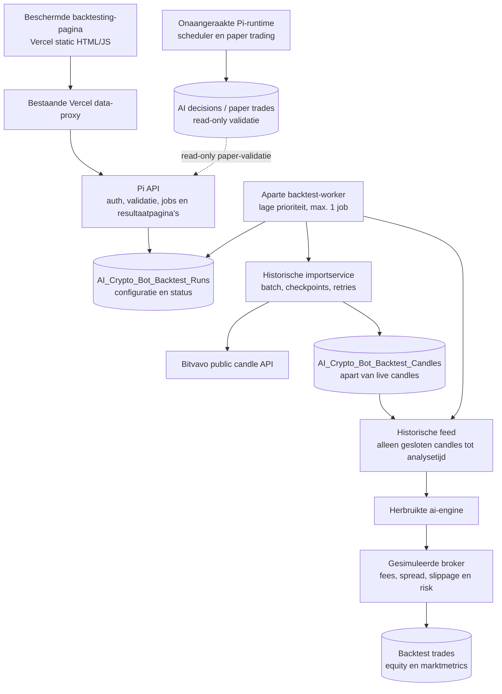

# Phase 16.1 — Backtesting Engine Implementatieplan

**Status:** Voorstel; nog geen implementatie goedgekeurd
**Scope:** Historische candle-backtesting vanuit het bestaande dashboard
**Relatie met Phase 16:** Aanvullende fase. Phase 16 Strategy Simulation blijft behouden en krijgt een andere, lichtere functie.

## 1. Doel en afbakening

Paper trading levert nog weinig trades op voor betrouwbare strategievalidatie. Phase 16.1 voegt daarom historische replay toe: de bestaande deterministische strategie analyseert historische data en een afzonderlijke gesimuleerde broker verwerkt orders. De backtest mag geen invloed hebben op paper trading, live runtime, bestaande portfolio's, trades of AI-beslissingen.

De huidige Phase 16 Strategy Simulation blijft de lichte simulator op bestaande AI-beslissingen, paper trades en Analytics-data. Die vergelijkt onder andere confidence-drempels, marktselectie, allocatie en risicoprofielen. Phase 16.1 doet de zwaardere candle-replay en kan nieuwe historische signalen evalueren.

Beide functies kunnen in hetzelfde dashboard beschikbaar zijn, maar moeten hun gegevensbron en simulatiemethode duidelijk benoemen. Resultaten van de twee modi zijn niet zonder meer vergelijkbaar.

### Buiten scope

- Automatische strategie- of parameterwijzigingen.
- Writes naar live AI-decision-, paper-trading-, positie-, portfolio- of statusgegevens.
- Live trading, exchange-orders of wijzigingen aan `ENABLE_LIVE_TRADING`.
- Walk-forward-optimalisatie; dit blijft een latere fase.
- Vercel Cron, een nieuwe Vercel Serverless Function of zware infrastructuur zoals Redis/Celery.

## 2. Bestaande code en hergebruik

- [`raspberry-pi/src/services/ai-engine.mjs`](../raspberry-pi/src/services/ai-engine.mjs): hergebruik `analyzeMarket()` en de bestaande indicatoren. De engine neemt marktdata, candles en analysetijd als invoer; maak geen tweede indicator-implementatie.
- [`raspberry-pi/src/services/ai-analysis-service.mjs`](../raspberry-pi/src/services/ai-analysis-service.mjs): gebruik dit niet als backtest-runner; deze service haalt live gegevens op en schrijft AI-beslissingen weg.
- [`raspberry-pi/src/services/paper-trading-service.mjs`](../raspberry-pi/src/services/paper-trading-service.mjs): gebruik dit niet direct voor replay; de service is gekoppeld aan live repositories en transacties. Deel uitsluitend zuivere regels/berekeningen als regressietests aantonen dat paper-gedrag gelijk blijft.
- [`raspberry-pi/src/services/position-exit-policy.mjs`](../raspberry-pi/src/services/position-exit-policy.mjs): hergebruik de zuivere exit-policy waar de OHLC-replay dezelfde observatie- en fillregels kan leveren.
- [`raspberry-pi/src/services/bitvavo-public-client.mjs`](../raspberry-pi/src/services/bitvavo-public-client.mjs), [`market-data-ingestion.mjs`](../raspberry-pi/src/services/market-data-ingestion.mjs) en [`market-ingestion-repository.mjs`](../raspberry-pi/src/repositories/market-ingestion-repository.mjs): hergebruik waar passend de Bitvavo-public adapter, datavalidatie, checkpoints en batchpatronen. Houd backtesthistorie gescheiden van live candles.
- [`raspberry-pi/src/api/data-routes.mjs`](../raspberry-pi/src/api/data-routes.mjs), [`lib/runtime-api-proxy.mjs`](../lib/runtime-api-proxy.mjs) en [`api/dashboard-data.mjs`](../api/dashboard-data.mjs): breid de bestaande Pi-API en allowlisted proxy uit; voeg geen Vercel-functie toe.
- [`docs/RISK_MANAGEMENT.md`](../docs/RISK_MANAGEMENT.md), [`docs/DATABASE.md`](../docs/DATABASE.md), [`docs/ARCHITECTURE.md`](../docs/ARCHITECTURE.md), [`docs/API.md`](../docs/API.md), [`docs/TESTING.md`](../docs/TESTING.md) en [`docs/SCHEDULING.md`](../docs/SCHEDULING.md): actualiseer waar de implementatie dit vereist.

De documentatie noemt al `AI_Crypto_Bot_Backtests`, maar de actuele Pi-schema-objecten moeten read-only worden gecontroleerd voordat een migratie wordt ontworpen. Hergebruik het bestaande object als dat contract past; maak niet ongemerkt een tweede concurrerende tabel.

### AI-decision- en paperdata

`AI_Crypto_Bot_AI_Decisions` hoort bij de paper-periodevalidatie als **read-only referentie**, niet als bestemming voor nieuw gegenereerde backtestbeslissingen. De backtest gebruikt eigen `AI_Crypto_Bot_Backtest_*`-resultaten.

Voor een normale historische replay wordt marktdata uit de candle-feed opgebouwd. Voor de paper-periode kunnen opgeslagen AI-beslissingen, hun `indicators.marketData`-snapshot, trades en beschikbare execution-auditgegevens worden gebruikt om beslissingen en uitvoering te vergelijken. De actuele `AI_Crypto_Bot_Market_Data`-tabel bevat geen volledige historische tickerreeks.

De backtest vult op de open van de volgende 5m-candle; de paper-engine gebruikt de actuele opgeslagen marktprijs. Exacte trade-voor-trade-gelijkheid is daarom niet de acceptatie-eis. Rapporteer verschillen expliciet en vergelijk daarnaast de beslissingen afzonderlijk.

## 3. Voorgestelde architectuur

De worker is een apart proces/systemd-service, niet een stage in de bestaande runtime-cycle en niet een Vercel-functie. Een aparte databasegebruiker krijgt alleen de minimaal noodzakelijke leesrechten op de historische input en schrijf-/leesrechten op backtestobjecten. De worker krijgt geen schrijfroute naar paper- of live-tabellen.

Een apart proces beschermt niet tegen alle resourceconcurrentie: PostgreSQL en de SD-kaart blijven gedeeld. Als absolute nul-impact vereist is, moet de zware replay buiten de Pi plaatsvinden.

## 4. Replay- en handelsregels

1. De standaard analysecadans is één beoordeling per gesloten 5m-candle, in lijn met de runtime-cyclus.
2. Een beslissing op tijdstip `t` mag alleen volledig gesloten candles gebruiken waarvan de sluiting uiterlijk `t` is. Hogere timeframes moeten op dat moment eveneens gesloten zijn.
3. Een order uit die beslissing wordt gevuld op de **open van de volgende 5m-candle**, met adverse slippage en een expliciet spread-model. Bij ontbrekende/gap-candles wordt niet stilzwijgend op een gunstige prijs gevuld.
4. Gebruik één gedeeld portfolio over de geselecteerde markten; verwerk gelijke tijdstippen deterministisch. Marktranking rapporteert marktbijdragen, niet alsof iedere markt een onafhankelijk portfolio met hetzelfde startkapitaal heeft.
5. Startkapitaal als standaard: €2.000, configureerbaar per run.
6. Gebruik de actuele paper-riskconfiguratie als baseline: maximaal 10% positiegrootte, maximaal 9 open posities, minimale executor-confidence 70, 15 minuten cooldown, 0,25% fee, 0,10% slippage, 5% dagelijkse drawdownlimiet, 15% maximale portfoliodrawdown en 20% emergency stop.
7. Exitregels moeten de actuele paper-policy representeren: gemodelleerde verliesgrens, €3 net-profitvloer en 1,5 × 5m-ATR trailing exit. Er is geen vaste take-profit. OHLC-data onthult geen intrabar-volgorde; bij ambiguïteit geldt een vooraf vastgelegde conservatieve regel.
8. Backtestresultaten staan los van paper-resultaten. Iedere run bewaart configuratie, engineversie, dataperiode, dataset-checksum en resultaatstatus.
9. Stel initieel een chronologische 70/30 in-sample/out-of-sample-splitsing voor. OOS wordt niet gebruikt voor parameterkeuze. Walk-forward blijft buiten deze fase.

### Metrics

Per run: rendement/netto-P&L, win rate, profit factor, drawdown, Sharpe, aantal trades, gemiddelde winst/verlies en geaggregeerde equity. Per markt: trades, win rate, netto-P&L, profit factor en bijdrage aan drawdown. Toon open eindposities apart en tel ze niet als gerealiseerde trades.

Equity-curves worden gedownsampled met een expliciete limiet per run; drawdown en overige metrics worden over de volledige replay berekend, niet alleen over de getoonde punten. De Sharpe-definitie en annualisatiebasis moeten worden vastgelegd en versieerbaar zijn.

## 5. Dashboard- en API-scope

De beschermde dashboardpagina biedt:

- Periode, marktselectie, timeframes/uitvoeringsinterval, parameters, kapitaal en kostenmodel configureren.
- Jobstatus `pending/running/done/failed/cancelled`, voortgang, foutcode en annuleren.
- Per run metrics, equity, drawdown, trades en ranking per markt.
- Runs vergelijken en verwijderen met bevestiging.

Gebruik bestaande HTML/CSS/JavaScript- en Chart.js-patronen. Een aparte statische `backtesting.html`/`js/backtesting.js` is voorstelbaar, met aanpassing van bestaande beschermde-pagina-routing. API-requests lopen via de bestaande Pi-data-route en Vercel-proxy. Er wordt **geen** nieuw bestand onder `/api` of nieuwe Vercel Serverless Function toegevoegd.

Resultaten moeten gepagineerd en begrensd zijn. Valideer gebruikersinvoer, sessie en CSRF bij start-, annuleer- en verwijderacties. Verwijderen wist alleen de geselecteerde run/resultaten; nooit paperhistorie of candlehistorie die nog door andere runs wordt gebruikt.

## 6. Databasevoorstel en opslag

Alle nieuwe tabellen/indexen volgen `AI_Crypto_Bot_`. Bestaande tabellen blijven ongewijzigd.

| Object (voorstel) | Inhoud en indexen |
|---|---|
| `AI_Crypto_Bot_Backtest_Candles` | Historische OHLCV; unieke sleutel `(symbol, interval, timestamp)`. Gescheiden van `AI_Crypto_Bot_Candles`. |
| `AI_Crypto_Bot_Backtest_Candle_Imports` | Hervatbare checkpoint/status per markt en interval; primaire sleutel markt+interval. |
| `AI_Crypto_Bot_Backtest_Runs` | Run/job, parameters, dataperiode, status, voortgang, versies, checksums en foutcode. Eerst controleren of `AI_Crypto_Bot_Backtests` hiervoor geschikt is. Unieke partial index garandeert maximaal één actieve job. |
| `AI_Crypto_Bot_Backtest_Trades` | Gesimuleerde entries/exits, fillprijs, fees, slippage, markt, timestamps, P&L en exitreden; index op run en tijd/markt. |
| `AI_Crypto_Bot_Backtest_Equity` | Begrensde curve per run; index op run en timestamp. |
| `AI_Crypto_Bot_Backtest_Market_Metrics` | Metrics per run/markt; unieke sleutel run+markt. |

Sla niet elke HOLD/WAIT-beslissing op; dat verhoogt opslag zonder dat het nodig is voor de gevraagde runresultaten. Bewaar wel alle gesimuleerde trades, runconfiguratie, gebruikte engineversie en datasetidentiteit.

### Opslagdoel en grenzen

Zes maanden voor 101 markten over alle zes intervallen is ongeveer **34,2 miljoen candles**. Bij een grove schatting van **150–220 bytes per candle inclusief één unieke index** betekent dit ongeveer **5,1–7,5 GB** historische opslag, bovenop de gemelde huidige databasegrootte van circa 250 MB. Dit is een raming, geen gemeten Pi-resultaat.

- Eerst meten met een representatieve één-markt/één-maand import en `pg_total_relation_size`.
- Waarschuw rond 8 GB totale databasegrootte; pauzeer verdere imports rond 9 GB; 10 GB is de absolute bovengrens.
- Meet ook vrije SD-ruimte met `df`; PostgreSQL heeft ruimte nodig voor WAL, onderhoud en tijdelijke bestanden. Start geen import als de ingestelde vrije-ruimtebuffer niet gehaald wordt.
- Geen stille automatische verwijdering bij een opslaggrens. Pauzeer, rapporteer en vraag goedkeuring voor een retentiewijziging.
- De zesmaands/101-markt-run is een doel voor capaciteit, **niet** de eerste Pi-run. Begin op de Pi met één markt en korte periode; schaal daarna naar bijvoorbeeld 10–20 markten/90 dagen. De volledige scope wordt alleen op Pi uitgevoerd na gemeten CPU-, geheugen-, database- en runtime-impact; anders blijft die off-Pi.

De Bitvavo-client begrenst requests op 500 candles. De volledige zesmaandsdataset vraagt minimaal ongeveer 68.000 maximaal gevulde API-requests; het werkelijke aantal kan hoger zijn. Gebruik hervatbare checkpoints, backoff bij rate-limits en batches; nooit één commit per candle.

## 7. Implementatiefasering

Elke stap is zelfstandig te testen. Er wordt na elke goedgekeurde projectfase gestopt voor review; productie-migraties, Pi-rollout en deployment blijven operator-goedgekeurd.

| Stap | Doel en betrokken locaties | Risico’s | Tests |
|---|---|---|---|
| **0 — Schema/capaciteit** | Read-only Pi-controle, baseline DB/SD/CPU/RAM/runtime. Documentatie onder `docs/`. | Documentatie kan afwijken van live-schema. | Schema-, grants-, index- en opslagcontrole; geen writes. |
| **1 — Feed/broker-contracten en CLI** | Aparte `raspberry-pi/src/services/`-modules; bestaande AI-engine als enige beslislogica. Eén markt, korte fixture/periode. | Paper-enginegedrag kan veranderen door gedeelde code. | Golden-enginefixtures, regressietests voor paper; bewijs dat live tabellen niet worden geschreven. |
| **2 — Historische import** | Nieuwe repository/service en checkpoint-objecten; één markt/interval. | Rate-limits, gaten, revisions en SD-writes. | 429/backoff, herstart, duplicates/upsert, timestamp-alignment, idempotency en batchcommit-tests. |
| **3 — Replay en risicobroker** | Next-open fills, fees/spread/slippage, sizing, risk en exits. | Lookahead, gap- en intrabar-ambiguïteit. | Lookahead- en next-open-regressies; fees, cooldown, posities, drawdown, trailing exit, reproducibiliteit. |
| **4 — Beperkte multi-market run** | Eén gedeeld portfolio; 10–20 markten/90 dagen als kandidaat voor de eerste Pi-benchmark. | Gedeelde cash en gelijktijdige orders veranderen volgorde/resultaat. | Deterministische eventvolgorde, chunk-geheugen, benchmark met vaste dataset. |
| **5 — Worker en jobstatus** | Aparte Node/systemd-service; begrensde DB-rol, één job, status, cancel, timeout en herstel. | DB/SD-contestie en achtergebleven jobs. | Concurrentiestart, crash/restart, timeout, cancel per chunk en Pi-belastingstest. |
| **6 — API en dashboard** | Bestaande Pi-routes/proxy; beschermde UI en paginatie. | Ongeautoriseerde jobs, te grote responses, foutieve deletes. | Auth/CSRF, validatie, maximum één job, UI-statussen, vergelijken, bevestigde delete en mobiele layout. |
| **7 — Validatie en opschaling** | Paper-periodevergelijking, OOS en eventuele groei richting zes maanden/101 markten. | Beperkte historie en andere fills dan paper. | Read-only vergelijking met AI-decisions/trades/audit, OOS-leakagetests en Pi-soaktest met live runtime actief. |

## 8. Resourcebudget en fail-safe gedrag

Startwaarden zijn voorstellen die eerst op Pi-hardware moeten worden gemeten:

- Maximaal één worker/job.
- Eén backtestdatabaseverbinding extra; korte keyset-pagina’s en geen lange transacties tijdens berekeningen.
- `nice`/`ionice` en systemd CPU-/geheugen-/I/O-limieten. Begin als meetbare hypothese met circa 10–20% van één core en 128–192 MB geheugenplafond; niet als bewezen veilige limiet behandelen.
- Houd alleen begrensde batches/rolling windows in geheugen; laad nooit volledige historische reeksen of alle marktgeschiedenis.
- Annulering wordt tussen batches gecontroleerd; jobtime-out is verplicht en configureerbaar. Timeout laat de job gecontroleerd falen met behoud van diagnostiek, niet van live-state-writes.
- Monitor runtime-cycleduur, dashboard/API-latency, CPU, RSS, databasegrootte en vrije SD-ruimte. Pauzeer of stop de backtest als ingestelde grenzen worden overschreden.
- De worker verandert geen `AI_Crypto_Bot_Status`, runtime scheduler, paper-runs of portfolio-state.

Als nul-impact op de Pi een absolute eis blijft, is een aparte rekenmachine nodig. Een proces, databasegebruiker en lage prioriteit op dezelfde Pi beperken impact, maar kunnen gedeelde schijf-/databaseconcurrentie niet uitsluiten.

## 9. Risico’s, aannames en open beslissingen

1. **Historische snapshotkwaliteit:** live `AI_Crypto_Bot_Market_Data` bewaart de laatste snapshot, niet de volledige tickerreeks. Beslissingspariteit geldt alleen voor tijdstippen waarvoor opgeslagen beslissing-snapshots en benodigde candle/auditgegevens bestaan.
2. **Spread:** OHLC-candles leveren geen historische bid/ask. De spread moet een expliciete, versieerbare runparameter zijn; een representatieve waarde moet nog worden gekozen. Zonder die waarde mogen resultaten niet als volledig kostengemodel worden gepresenteerd.
3. **Intrabar-exits:** de volgorde van high/low binnen één candle is onbekend. Leg een conservatieve fillregel vast voordat code wordt geschreven.
4. **Sharpe-definitie:** leg return-interval, annualisatie en eventuele risk-free-aanname vast; maak de methode zichtbaar in de runconfiguratie.
5. **Retentie en reproduceerbaarheid:** zes maanden is het doel, maar oudere candledata kan nodig zijn om een bewaarde run te reproduceren. Definieer vóór automatische cleanup hoe rundata en candledata aan elkaar worden gekoppeld.
6. **Statistische bewijskracht:** meer candledata kan meer signalen opleveren, maar garandeert geen betrouwbare winstconclusie. Rapporteer aantallen, open posities, OOS-resultaten en beperkingen; claim geen winstgevendheid.
7. **Schema en migratie:** inspecteer live-Pi-schema en grants vóór migrationontwerp. Volg [`docs/DATABASE.md`](../docs/DATABASE.md) en de operatorprocedure; geen productie-write/migratie zonder expliciete autorisatie.
8. **Documentatie na implementatie:** werk bij wijziging aan functionaliteit minstens README, ROADMAP, CHANGELOG en de direct relevante API-, database-, architectuur-, risico-, deployment- en testdocumentatie bij. Fase-/validatierapporten horen in `docs/reports/`.

## 10. Acceptatie voor latere implementatie

- Phase 16 Strategy Simulation blijft onafhankelijk en ongewijzigd.
- De backtester deelt de bestaande deterministische beslislogica, gebruikt een aparte feed/broker en schrijft geen live/paper-data.
- Replay heeft bewezen next-open-fill en geen lookahead/data leakage.
- Jobs zijn begrensd, hervatbaar, annuleerbaar, time-out-beveiligd en maximaal één tegelijk.
- Pi-impact en opslag zijn daadwerkelijk gemeten; de zesmaands/101-markt-scope wordt niet geactiveerd op basis van schattingen alleen.
- API en UI gebruiken bestaande Vercel-proxy-infrastructuur; het aantal Vercel-functies neemt niet toe.
- OOS, reproduceerbaarheid, kostenmodel, beperkingen en paper-pariteitsverschillen zijn zichtbaar en getest.

**Geen code, databasewijziging, deployment of tests maken deel uit van dit implementatieplan. Uitvoering start pas na afzonderlijke goedkeuring.**
